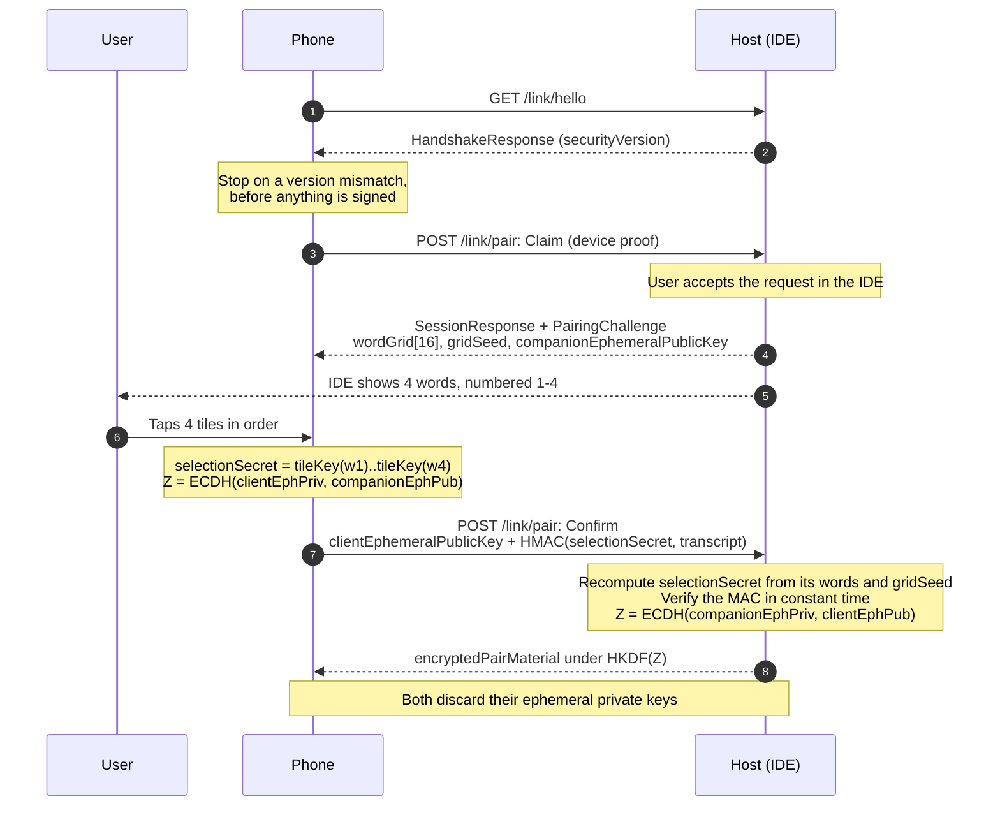
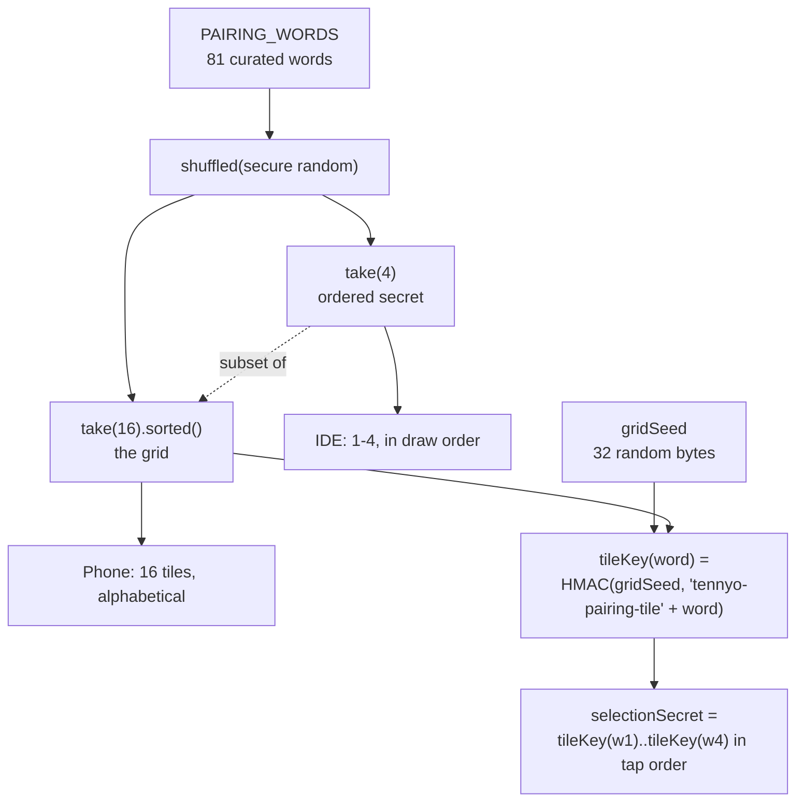
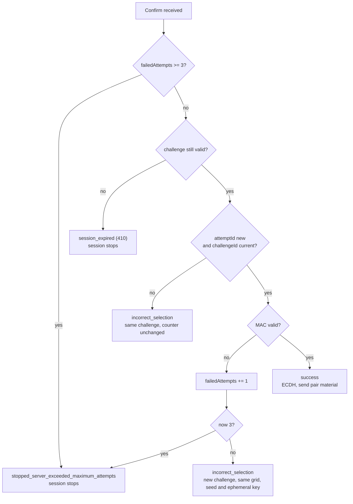

# Pairing design

This document explains why pairing works the way it does and which mistakes would break it without any visible
symptom. The wire format is in [Link protocol](link-protocol.md).

## The word grid

The IDE shows **four words in order**. The phone shows a **grid of sixteen words**, and the user taps the four in that
order. The phone never learns which tiles are right.

Tapping beats typing a passphrase because of the three-attempt limit. With typing, a typo costs an attempt just like
an attacker's guess, so three slips end the session. Tapping rules out typos, and the user reviews the selection
before sending it, so a mis-tap costs nothing.

### Security model

Guessing is limited **online only**, to three attempts.

| Design                | Guess space | Bits  | Chance in 3 attempts |
|-----------------------|-------------|-------|----------------------|
| **4 ordered of 16**   | **43,680**  | **15.41** | **6.9 × 10⁻⁵**   |
| 4 unordered of 16     | 1,820       | 10.8  | 1.6 × 10⁻³           |

- Someone who can read the IDE screen wins regardless.
- The ECDH exchange (below) stops *offline* recovery of the pair secret from a recorded exchange. It does not change
  the online bound.

Two invariants are easy to undo by accident:

| Invariant | Why |
|---|---|
| The selection **authenticates** the exchange and never encrypts anything | Otherwise the long-lived pair secret would travel under a 15-bit key, and a recorded exchange could be brute-forced offline |
| One numeric security version, bound into every transcript and checked at `hello` | Labels cannot disagree with it, and a stale app reports a version mismatch instead of a bad signature |

### Tile keys

Each tile has a word, which the user sees, and a key, which goes into the proof. The keys are **not secret**: the
phone receives the whole grid and the `gridSeed` that derives every key. The secret is which four tiles, in which
order, no matter what the tiles carry.

Keys exist to keep presentation apart from cryptography:

- Words are only presentation; they could be translated or replaced with icons.
- Fixed-length keys concatenate unambiguously, so the word list needs no prefix-free rule for security.
- No text normalization (case, whitespace) happens anywhere in the crypto path, so it cannot drift between platforms.

## Exchange

The transcript MACed with `selectionSecret` (`tennyo-pairing-connect`) covers the security version, session id,
SHA-256 of the token, TLS fingerprint, endpoint, device public key, device fingerprint, attempt id, server challenge
**and both ephemeral public keys**.

Remembered-pair resume and discovery connect follow the same split: the pair secret authenticates a transcript that
covers both ephemeral public keys, and the rotated pair material and the ticket travel under an ECDH-derived key. A
leaked pair secret plus recorded traffic therefore cannot decrypt a later rotation. Discovery uses a fresh key pair
per challenge; resume reuses the session's key pair, which is discarded with the session.

## Building the grid

**One shuffle produces both** the secret and the grid (`newPairingSecret` in `host/engine/.../pairing/PairingSecret.kt`).
Because the right words and the decoys come from a single uniform draw, sorting the grid removes all positional
information, and the secret and decoys are distinct by construction.

The grid, the seed and the host's ephemeral key are **created once per session** and reused by every challenge,
including rotated ones. The right words never change, so a new grid per retry would add no security and would make the
user search the grid again.

Tile keys depend on the **word, not its position**, so either side can re-sort the grid. All sixteen come from one
uniform seed, so a key cannot reveal whether its tile is right.

### Word list

The 81 words follow one testable rule: **at most seven letters, and no two words share their first two letters.**
That removes confusable groups such as Sierra/Signal/Silver or Meadow/Merry/Meteor, keeps every tile narrow on a phone,
and makes the list prefix-free.

There is deliberately no adjective/noun pattern. A known `adjective noun adjective noun` shape would tell an attacker
the type of each slot and shrink the search space about fourteen times. Digits are left out for the same reason: a lone
number tile gives itself away.

## Confirming the selection

Rules to keep:

- A reused `attemptId` or an old `challengeId` answers `incorrect_selection` **without** counting an attempt and
  **without** rotating, so replays cannot lock the user out.
- Rotation never resets `failedAttempts` or clears the used attempt ids, so reloading the grid buys no attempts.
- A rotated challenge keeps the session deadline. A failure at 110 seconds leaves 10 seconds; extending the deadline
  would give an attacker unlimited time.
- The phone clears its selection on `incorrect_selection`, so a mis-tap cannot cost a second attempt by resending the
  same answer.
- A valid MAC with an unusable ephemeral key counts as an ordinary failure, so the caller never learns its taps were
  right.

## Silent failures

These mistakes break security without failing an obvious test or showing a symptom. Check them first in any review.

1. **Sorting the secret.** The grid is sorted, but the secret must stay an independent random order. If the tap order
   can be derived from the grid (by sorting the secret on either side, or picking it by grid position), the guess space
   drops from P(16,4) = 43,680 to C(16,4) = 1,820. Covered by `pairing proof rejects the correct words in the wrong
   order` and `pairing secret order is not the sorted grid order` in `LinkSecurityTest`.
2. **Leaving an ephemeral key out of the MAC.** If either ephemeral public key is missing from the transcript, a
   machine in the middle can substitute its own, and the ECDH step authenticates nothing while everything still seems
   to work. Covered by `pairing proof rejects a substituted client ephemeral key`.
3. **Key encoding on iOS.** Security.framework exports raw X9.63 points (`0x04 || X || Y`), while the protocol uses
   SPKI. `PlatformCrypto.ios.kt` in `:shared:crypto` converts every key at that boundary; an ephemeral key that skipped
   it would fail only at the last pairing step.

Also:

- `wordGrid` must be serialized as a `List`, never a `Set`. A `LinkedHashSet` built as `correct + decoys` would put the
  four right words first on the wire.
- Tile keys, the grid, `gridSeed` and the selected words are never logged.

## Versioning

`ProtocolVersions.SECURITY_VERSION` (currently `2`) versions every security construction. Transcript labels carry no
version suffix; the number is a line of every transcript instead. A version bump therefore changes every proof and
key at once, and no label can disagree with the number.

The version is checked **at `hello`** on both sides:

- the phone checks `HandshakeResponse.securityVersion` before signing anything;
- the host answers `426 Upgrade Required` with `protocol_version_unsupported`, and closes a channel whose `Open`
  carries another version with the same code.

Every `DeviceProof` carries `securityVersion`, which is what the host checks, so **request bodies do not repeat it**.
A second copy in a body the host never reads would be a second source of truth that could disagree with the proof
while every test passes. The one exception is `DiscoveryConnectRequest`: discovery connect skips `hello`, so its body
field is that path's only version check, and it runs before the proof is verified.

Proof verification never compares versions. A mismatch is always `protocol_version_unsupported`, so a signature
failure always means a bad signature, and a stale app never looks like an attack.

A version bump changes every transcript, so **all stored remembered pairs become unusable**. The change that bumps the
version must delete them on both sides; otherwise resumes fail silently and fall back to pairing again.

## Out of scope

- **Offline resistance of the selection.** The selection is not a PAKE and relies on the pinned TLS channel to keep
  the exchange confidential. A real fix (SPAKE2 or CPace) needs an elliptic-curve dependency in `commonMain`.
- **Debug TLS.** Debug Android builds (`TransportPins.android.kt`) trust a user-installed proxy CA so traffic can be
  inspected. Release builds keep strict pinning. This is intended.
